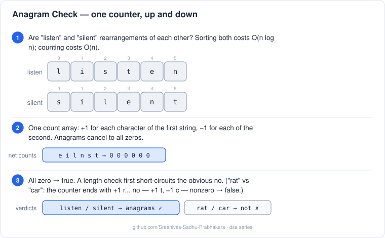

# Check Anagrams

> Striver SDE Sheet 101 · Day 16 String II — one counting array, incremented by one string and decremented by the other; anagrams cancel to zero. Go, stdlib only, tested.

## Problem

Are two strings anagrams — the same multiset of characters? `"listen"` / `"silent"` yes; `"aab"` / `"abb"` no (multiplicity matters).

## Approach

Sorting both strings and comparing works at O(n log n); counting beats it because equality of multisets only needs per-character tallies. One fixed-size array serves both strings — increments from the first, decrements from the second — so the final check is "all zeros", and the early length test makes a single combined pass sound. The array-vs-hashmap choice is the texture here: a 256-slot array is cache-resident and allocation-free, the right call for byte alphabets; a map earns its overhead only when the alphabet is unbounded (runes).

**Complexity:** O(n) time, O(1) space (fixed alphabet).

## Visual walkthrough

Read the picture top to bottom — each numbered frame is one moment of the algorithm
running on this repo's test example.

## Run

    go test ./...   # verify
    go run .        # demo

---

One of 191 repos solving Striver's SDE Sheet in Go — stdlib only, one problem per repo, every solution tested. Browse the set: [`dsa-*` repos](https://github.com/Sreenivas-Sadhu-Prabhakara?tab=repositories&q=dsa-&type=source).
